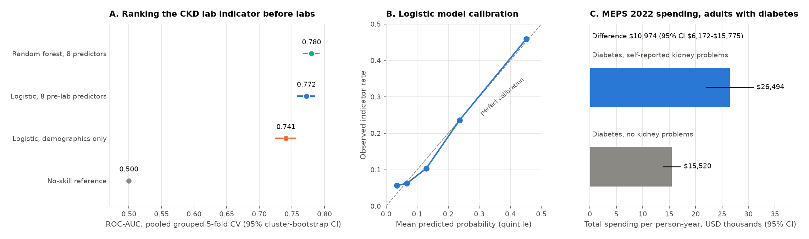

# CKD Launch Intelligence

How many U.S. adults have laboratory signs of chronic kidney disease (CKD), can information collected before any kidney test find them, and what does kidney damage add to the cost of diabetes care? Most people with CKD don't know they have it, so these are the sizing, targeting and value questions behind any kidney screening program or therapy launch. This project answers them from public CDC, AHRQ, CMS and ClinicalTrials.gov data and serves the results through a typed API and a dashboard.

## Key results

| Question | Result | Uncertainty and baseline |
|---|---|---|
| Share of U.S. adults with the CKD lab indicator (eGFR <60 or UACR ≥30 mg/g) | **13.9%** | 95% CI 12.5–15.3%; survey-weighted, n = 5,016 |
| How well 8 pre-lab predictors rank who has it (logistic regression) | **ROC-AUC 0.772** | 95% CI 0.759–0.784; no-skill 0.500; demographics only 0.741 |
| What the clinical predictors add over age, sex and race/ethnicity | **+0.031 ROC-AUC** | paired 95% CI +0.018 to +0.045 |
| Yield of screening the top 10% by predicted risk | **55.7% positive**, 30.3% of all positives found | base rate 18.4% (3.0× lift) |
| Extra yearly health spending for adults with diabetes who report kidney problems | **+$10,974** per person ($26,494 vs $15,520) | 95% CI $6,172–$15,775; MEPS 2022 |
| Registered CKD studies on ClinicalTrials.gov | **3,706**, of which 419 recruiting | full snapshot, 2026-09-11 |



Numbers come from `data/processed/patient_need_summary.json`, `patient_finding_model_comparison.json`, `meps_hc243_2022_landscape.json` and `clinicaltrials_ckd_landscape.json`. The [model card](docs/models/patient-finding-model-card.md) has calibration, subgroup and definition-sensitivity results.

## Approach

- **Design-based survey estimation.** NHANES and MEPS estimates use the published weights, strata and PSUs with Taylor-series linearization and Student-t intervals. Subpopulations are estimated as domains of the full design, never by subsetting rows. Results match R `survey` to four decimals (checked in the test suite).
- **Outcome definition.** Race-free CKD-EPI 2021 eGFR plus the albumin-to-creatinine ratio, with eGFR-only and albuminuria-only sensitivity versions on the same denominator. Missing labs are excluded, never counted as negative.
- **Leakage-controlled risk model.** An allowlist admits only pre-lab predictors (age, sex, race/ethnicity, BMI, blood pressure, diabetes, hypertension, smoking); any kidney-lab-derived column is rejected. Scaling and encoding are fit inside each training fold.
- **Grouped cross-validation and paired bootstrap.** Stratified grouped 5-fold CV over the 30 NHANES PSUs keeps survey clusters out of both sides of a split. 1,000 cluster-bootstrap replicates give intervals; model comparisons are paired on the same replicates. Logistic regression was pre-specified; a random forest and a demographics-only model are comparators, and a constant-prevalence model is the no-skill baseline.
- **Capacity-based operating point.** Performance is reported at a fixed screening capacity (top 10%), with precision, recall, quintile calibration and age and sex subgroups.
- **Source-specific market context.** Medicare Part D prescribing for SGLT2 inhibitors and finerenone and a fully paginated ClinicalTrials.gov snapshot stay at their own grain; nothing is joined across sources at the person level.
- **Product layer.** A FastAPI service serves only checksum- and manifest-verified artifacts with strict Pydantic schemas, including a JSON (not pickle) logistic scorer. A Dash dashboard reads only the API ([model page screenshot](docs/figures/dashboard_patient_finding.png)).

## Data

| Source | What is used | n and unit | Period | License |
|---|---|---|---|---|
| [CDC/NCHS NHANES](https://wwwn.cdc.gov/nchs/nhanes/continuousnhanes/default.aspx?BeginYear=2017) | 8 public-use files: demographics, biochemistry, urine albumin/creatinine, body measures, blood pressure, diabetes, hypertension and smoking questionnaires | 9,254 participants; 5,016 adults with both labs; 4,741 with all predictors | 2017-2018 cycle | U.S. government public domain |
| [AHRQ MEPS HC-243](https://meps.ahrq.gov/mepsweb/data_stats/download_data_files_detail.jsp?cboPufNumber=HC-243) | Full-year consolidated file, Diabetes Care Survey | 22,431 person records; 1,063 adults with diabetes and a kidney-problem answer | 2022 | U.S. government public domain |
| [CMS Medicare Part D Prescribers by Provider and Drug](https://data.cms.gov/provider-summary-by-type-of-service/medicare-part-d-prescribers/medicare-part-d-prescribers-by-provider-and-drug) | Empagliflozin, dapagliflozin and finerenone rows, aggregated to brand and prescriber state | 325,586 prescriber-drug rows | 2024 release | U.S. government public domain |
| [ClinicalTrials.gov API v2](https://clinicaltrials.gov/data-api/api) | Registered studies matching the CKD condition search | 3,706 studies | snapshot 2026-09-11 | NLM terms of use |

Raw files are not committed. `scripts/retrieve_surveys.py` downloads the NHANES and MEPS files and verifies each against the SHA-256 in `data/manifests/`. Only aggregate, identifier-free artifacts are committed.

The claims-journey and time-to-event demo (notebook 04) runs on a small handcrafted fixture in the CMS DE-SynPUF synthetic-claims layout. It exercises the code path only and says nothing about Medicare beneficiaries.

## Repository structure

```text
src/ckd_intelligence/   survey statistics, CKD definitions, NHANES loader, model, pipelines
scripts/                data retrieval, MEPS/Part D/trials builders, figure rendering
notebooks/              01 prevalence, 02 risk model, 03 market and trials, 04 journeys, 05 scenarios
data/manifests/         source URLs, SHA-256 digests and artifact checksums
data/processed/         committed aggregate artifacts with .sha256 sidecars
api/                    FastAPI service and schemas
dashboard/              Dash app (reads only the API)
sql/                    DuckDB/PostgreSQL marts mirroring the Python logic
tests/                  unit, contract, provenance and R-referenced statistics tests
docs/                   model card, metric and data dictionaries, lineage, source contracts
```

## Reproduce

Requires Python 3.12. From a fresh clone:

```bash
make install          # .venv with pinned requirements.txt
make test             # 311 tests, offline, about 30 s; PostgreSQL and raw-data tests skip
make lint typecheck   # ruff and strict mypy
```

Rebuild the analysis from the public source files:

```bash
make data             # download NHANES and MEPS files, verify SHA-256
make artifacts        # rebuild NHANES and MEPS artifacts and manifests
make figures          # docs/figures/key_results.png
make notebooks        # re-execute notebooks in place
```

The NHANES artifacts are deterministic: a rebuild reproduces the committed files byte for byte. Part D and ClinicalTrials.gov are dated API snapshots; `scripts/retrieve_partd.py` and `scripts/retrieve_clinicaltrials.py` fetch new ones. Without raw data the notebooks fall back to committed fixtures and write only to `data/processed/fixture/`.

Run the API and dashboard:

```bash
PYTHONPATH=.:src .venv/bin/uvicorn api.main:app          # http://127.0.0.1:8000/docs
PYTHONPATH=.:src .venv/bin/python -m dashboard.app       # http://127.0.0.1:8050
```

## Limitations

- NHANES measures each person once, so the indicator can't confirm the 3-month persistence that defines CKD, and single measurements overstate persistent disease.
- Model metrics are unweighted, internal cross-validation on one survey cycle. They describe this cohort, not U.S. population performance, and aren't external validation. Age dominates the ranking, so a single 10% capacity selects no adults under 40.
- The MEPS kidney measure is self-reported "diabetes has caused kidney problems" among adults with diabetes, not diagnosed CKD, and the spending gap is descriptive, not causal.
- Part D rows are prescriber-state aggregates for three selected generics; prescriber counts can't be summed across brands, and the data can't show indication or patient residence.
- Sources differ in population, geography and year, so the opportunity view compares them side by side and never combines them into one score.
